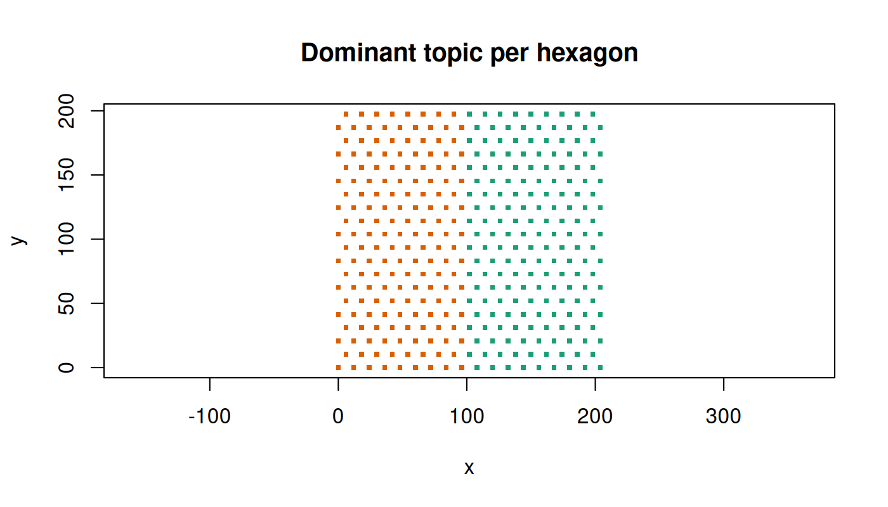

# Getting started with punkstR

punkstR runs the [punkst](https://github.com/Yichen-Si/punkst)
pixel-level factor-analysis pipeline on a SpatialData store, entirely
from R. It calls the `punkst` binary and a small export script with
[`system2()`](https://rdrr.io/r/base/system2.html); nothing is imported
into R from Python and punkstR never builds or installs punkst (see the
README for a build recipe).

This vignette uses a small synthetic store, so it runs in under a
minute. A real-data walkthrough (a Xenium breast cancer section with 42
million transcripts) is installed under
`system.file("largedemos", package = "punkstR")`.

The code is evaluated only when a `punkst` binary and a Python with
`spatialdata` are found (`PUNKST`, `PUNKST_PYTHON`, or on the `PATH`);
otherwise it is shown but not run.

## Check the setup

``` r

library(punkstR)
cfg <- check_punkst_setup()
```

    punkst binary : OK      /home/runner/work/punkstR/punkstR/punkst-0.1.2-linux-x86_64-glibc2.28/bin/punkst
    python/sdata  : OK      /opt/punkst-venv/bin/python-preload (spatialdata 0.8.0, zarr 3.4.2) 

``` r

can_run <- cfg@bin_ok && cfg@python_ok
knitr::opts_chunk$set(eval = can_run, fig.width = 7, fig.height = 4, dpi = 100)
```

[`check_punkst_setup()`](https://vjcitn.github.io/punkstR/reference/check_punkst_setup.md)
returns a `punkstConfig` object. It lists what is missing and never
installs anything.

## A synthetic store

[`sdata_demo()`](https://vjcitn.github.io/punkstR/reference/sdata_demo.md)
writes a SpatialData store with 60,000 transcripts of 20 genes: genes
`A0`-`A9` are enriched in the left half of the field and `B0`-`B9` in
the right. A two-topic model has something real to find.

``` r

work <- tempfile("punkstR_demo_")
dir.create(work)
zarr <- sdata_demo(file.path(work, "demo.zarr"))
info <- sdata_info(zarr)
info$points$transcripts$rows
```

    [1] 60000

``` r

names(info$points$transcripts$transformations)
```

    [1] "global"

## Run the pipeline

[`run_punkst_pipeline()`](https://vjcitn.github.io/punkstR/reference/run_punkst_pipeline.md)
exports the transcripts, tiles them (`pts2tiles`), aggregates them into
hexagons (`tiles2hex`) and fits a topic model (`topic-model`). Options
for each stage go in a named list; everything else takes punkst’s
defaults. Stages whose inputs and parameters have not changed are
skipped on re-runs.

``` r

run2 <- run_punkst_pipeline(
    zarr, file.path(work, "out"), threads = 2,
    export = list(coordinate_system = NULL),
    pts2tiles = list(tile_size = 100),
    tiles2hex = list(min_count = 5),
    topic_model = list(n_topics = 2, n_epochs = 5, min_count_train = 5))
run2
```

    <punkstRun>
      source     : /tmp/RtmpAa8WCR/punkstR_demo_1cbd3e9f5373/demo.zarr
      transcripts: /tmp/RtmpAa8WCR/punkstR_demo_1cbd3e9f5373/out/transcripts.tsv
    <punkstTiles> in /tmp/RtmpAa8WCR/punkstR_demo_1cbd3e9f5373/out
      tsv       /tmp/RtmpAa8WCR/punkstR_demo_1cbd3e9f5373/out/tiled.tsv
      index     /tmp/RtmpAa8WCR/punkstR_demo_1cbd3e9f5373/out/tiled.index
      coord_range /tmp/RtmpAa8WCR/punkstR_demo_1cbd3e9f5373/out/tiled.coord_range.tsv
      features  /tmp/RtmpAa8WCR/punkstR_demo_1cbd3e9f5373/out/tiled.features.tsv
    <punkstHex> in /tmp/RtmpAa8WCR/punkstR_demo_1cbd3e9f5373/out
      data      /tmp/RtmpAa8WCR/punkstR_demo_1cbd3e9f5373/out/hex_12.txt
      meta      /tmp/RtmpAa8WCR/punkstR_demo_1cbd3e9f5373/out/hex_12.json
      features  /tmp/RtmpAa8WCR/punkstR_demo_1cbd3e9f5373/out/tiled.features.tsv
    <punkstModel> in /tmp/RtmpAa8WCR/punkstR_demo_1cbd3e9f5373/out
      model     /tmp/RtmpAa8WCR/punkstR_demo_1cbd3e9f5373/out/hex_12.k2.model.tsv
      results   /tmp/RtmpAa8WCR/punkstR_demo_1cbd3e9f5373/out/hex_12.k2.results.tsv
      pseudobulk /tmp/RtmpAa8WCR/punkstR_demo_1cbd3e9f5373/out/hex_12.k2.pseudobulk.tsv

The result is a `punkstRun` object whose properties (`run2@hex`,
`run2@model`, …) are stage objects holding file paths and the parameters
used.

## Read the results

``` r

m <- punkst_read_model(run2@model)          # genes x topics
round(head(m[order(rownames(m)), ], 4))
```

          0   1
    A0 1463 331
    A1 1460 338
    A2 1453 327
    A3 1529 367

``` r

topics <- punkst_read_topics(run2@model)    # one row per hexagon
head(topics, 3)
```

           key  x        y      0      1
    1 01564f61 60 103.9230 0.9989 0.0011
    2 01954dd9 54 135.1000 0.9990 0.0010
    3 01f011e7 96 145.4923 0.8374 0.1626

Each topic should collect one family of genes:

``` r

frac_a <- vapply(as.data.frame(m), function(v)
    sum(v[startsWith(rownames(m), "A")]) / sum(v), 0)
round(frac_a, 2)
```

       0    1
    0.86 0.18 

and the topics should occupy different halves of the field:

``` r

tp <- topics[, -(1:3)]
top <- max.col(as.matrix(tp), "first")
plot(topics$x, topics$y, col = c("#d95f02", "#1b9e77")[top], pch = 15, cex = 0.5,
     asp = 1, xlab = "x", ylab = "y", main = "Dominant topic per hexagon")
```



## Try other settings and compare

Different tuning choices go in the same work directory; output names
carry the hexagon spacing and topic count, so runs do not overwrite each
other.

``` r

run3 <- run_punkst_pipeline(
    zarr, file.path(work, "out"), threads = 2,
    export = list(coordinate_system = NULL),
    pts2tiles = list(tile_size = 100),
    tiles2hex = list(min_count = 5),
    topic_model = list(n_topics = 3, n_epochs = 5, min_count_train = 5))
cmp <- punkst_compare_runs(run2, run3)
cmp$pairs
```

      topic_a topic_b    cosine
    1       0       2 0.9983933
    2       1       1 0.9965134

``` r

cmp$agreement
```

    [1] 0.9971429

[`punkst_compare_runs()`](https://vjcitn.github.io/punkstR/reference/punkst_compare_runs.md)
pairs each topic of one fit with its most similar topic of the other
(cosine similarity of gene loadings) and reports how often hexagons keep
their pairing.

## Write results back into a SpatialData store

[`sdata_writeback()`](https://vjcitn.github.io/punkstR/reference/sdata_writeback.md)
adds a run to a store as a `shapes` element of hexagons and a `table`
with counts, topic probabilities, gene loadings and the parameters that
produced them. By default it writes a new sidecar store; use
`in_place = TRUE` to add to the original.

``` r

side <- file.path(work, "demo_punkst.zarr")
sdata_writeback(run2, out = side)
sdata_writeback(run3, out = side)
runs <- sdata_runs(side)
runs[, c("run", "n_hexagons", "n_topics", "hex_size")]
```

            run n_hexagons n_topics hex_size
    1 hex_12_k2        350        2 6.928203
    2 hex_12_k3        350        3 6.928203

Both runs now live side by side in one store, ready to be read with
`spatialdata`, `anndata` or other SpatialData tooling.
